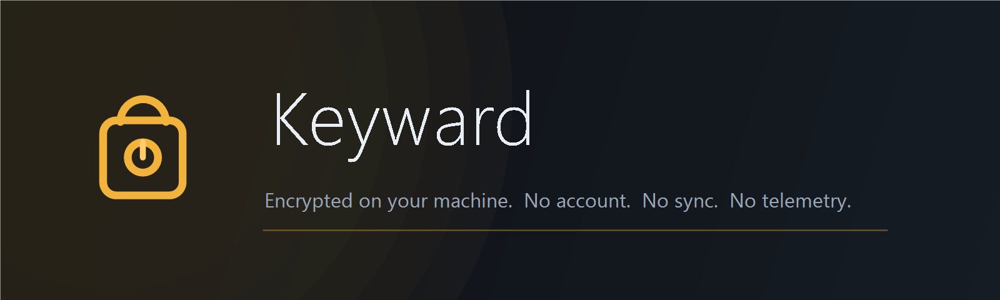
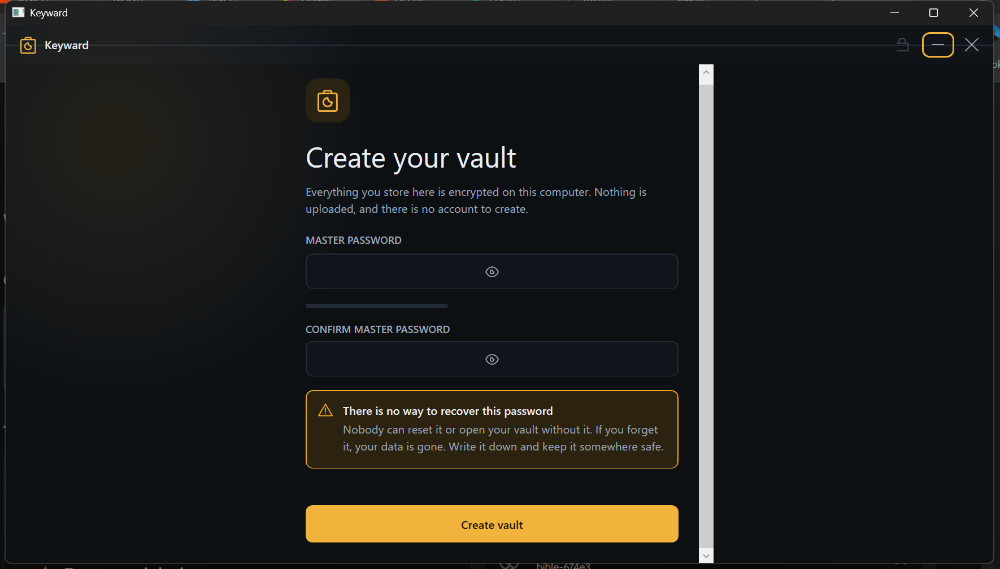
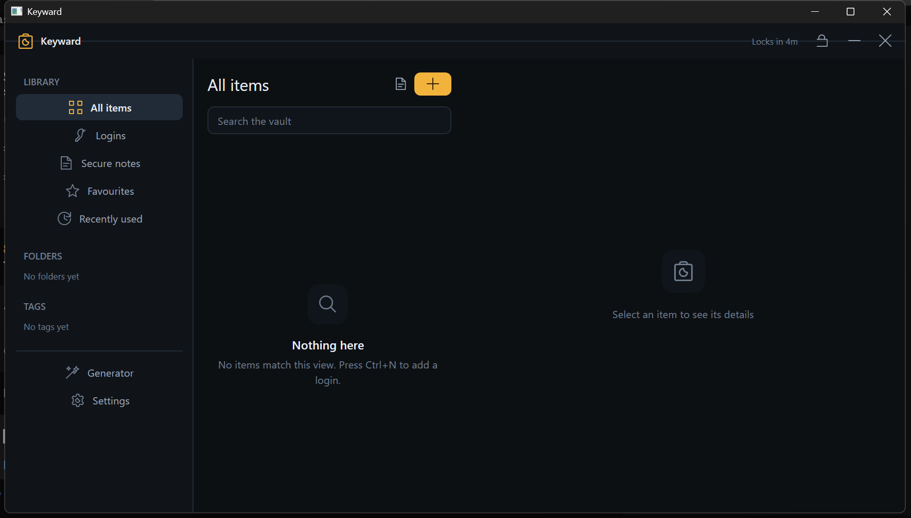
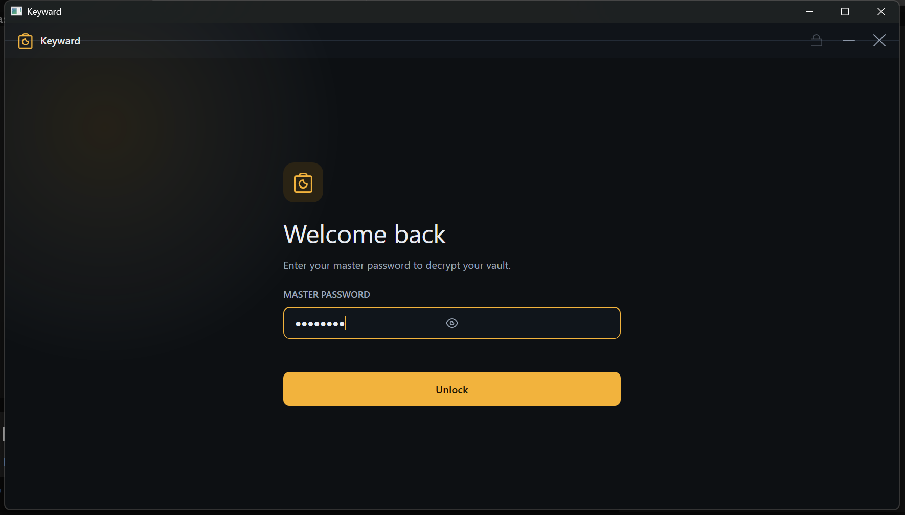
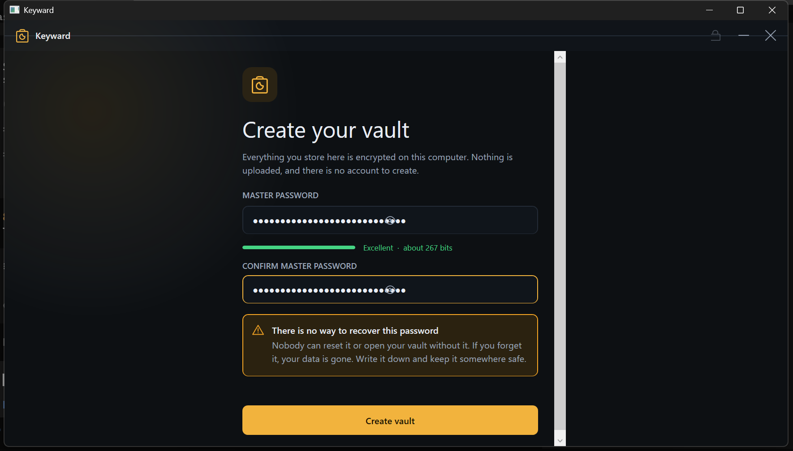
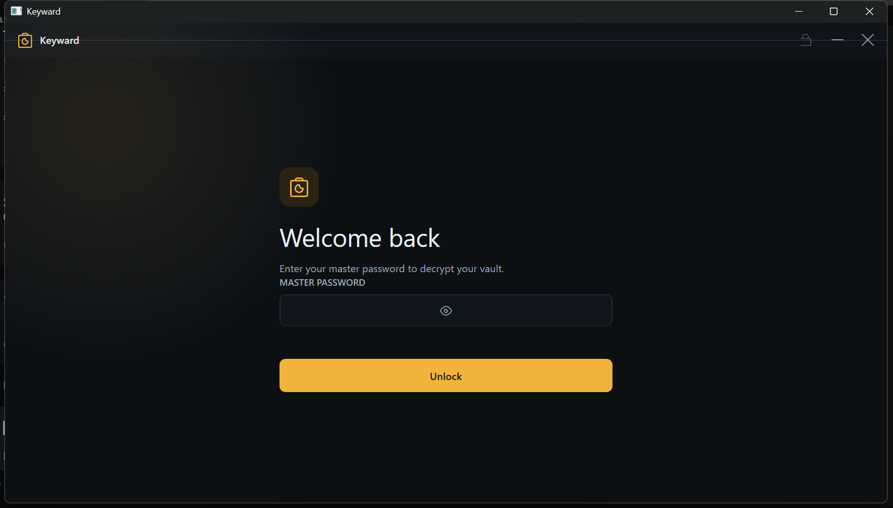
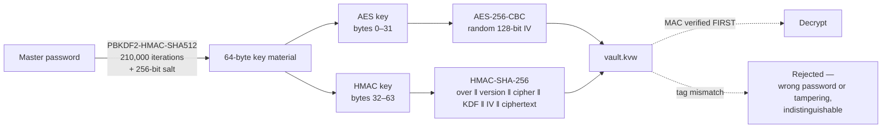

<div align="center">

<picture>
  <source media="(prefers-color-scheme: dark)" srcset="assets/banner.png">
  
</picture>

### A local-first password manager for Windows

**No account. No cloud. No telemetry. No recovery.**

[](LICENSE)
[](tests/)
[](docs/ENVIRONMENT.md)
[](docs/ENVIRONMENT.md)
[](docs/SECURITY.md)
[](https://github.com/TanimowoObaloluwaDavid/Keyward/commits)
[](LICENSE)

[Install](#-install) · [Screenshots](#-screenshots) · [Security](#-security-model) · [Build](#-build-from-source) · [Architecture](#-architecture) · [Limits](#-known-limitations)

</div>

---

## Why this exists

Every mainstream password manager asks you to create an account *before* it will hold a password.

**A password manager is the last place on your machine where an account is warranted.** You are
handing it the keys to everything else. Keyward keeps exactly one encrypted file on your disk, and
that is the entire product.

<p align="center">
  
  <br>
  <sub>It tells you up front, <em>before</em> you choose a password, that the password cannot be
  recovered — not by Keyward, not by anyone. After you commit, that information is worthless.</sub>
</p>

---

## Screenshots

<table>
<tr>
<td width="50%" align="center"><b>The vault</b><br><sub>rail · list · detail · live auto-lock countdown</sub></td>
<td width="50%" align="center"><b>Unlock</b><br><sub>a returning user, vault closed and encrypted</sub></td>
</tr>
<tr>
<td></td>
<td></td>
</tr>
<tr>
<td colspan="2" align="center"><b>Live strength guidance</b><br>
<sub>Estimated from the actual password — length, character classes, repeats and sequences — not a length rule of thumb.</sub></td>
</tr>
<tr>
<td colspan="2" align="center"></td>
</tr>
<tr>
<td colspan="2" align="center"><b>Generator</b><br><sub>passwords and pass-phrases from the OS CSPRNG</sub></td>
</tr>
<tr>
<td colspan="2" align="center"></td>
</tr>
</table>

---

## Features

<table>
<tr>
<td width="50%">

**🔐 Encryption at rest**
AES-256-CBC with HMAC-SHA256 encrypt-then-MAC. Tampering is *detected and rejected*, never silently decrypted.

**🔑 Real key derivation**
PBKDF2-HMAC-SHA512, 210,000 iterations, unique 256-bit salt per vault. Versioned and authenticated.

**🗝️ No recovery, by design**
Stated before you choose a password. No backdoor, no reset link, no "we can help".

**⏱️ Auto-lock that shows its work**
1 min – 1 hour, plus lock-on-sleep and lock-on-exit, with a live countdown in the title bar.

</td>
<td width="50%">

**📋 Logins & secure notes**
Username, password, URL, notes, tags, folders, favourites — all encrypted together.

**⚡ Unbiased generation**
OS CSPRNG with rejection sampling, so no character is measurably more likely than another.

**📋 Clipboard protection**
Auto-clear after 10 s – 5 min. It reports whether the clear actually worked, and will not wipe a
clipboard you have since reused.

**💾 Crash-safe writes**
Every save is atomic. A crash or a full disk mid-write cannot destroy your vault.

**🔄 Backups & rotation**
Encrypted backups, and master-password change that re-verifies the old password first.

</td>
</tr>
</table>

---

## Security model

The threat model, the cryptographic design, and — at least as importantly — **what this does not
protect against** are documented in full in [`docs/SECURITY.md`](docs/SECURITY.md).



### How the vault file is built

```jsonc
{
  "format": "keyward-vault",
  "version": 2,
  "kdf":    { "algorithm": "PBKDF2-HMAC-SHA512", "iterations": 210000, "salt": "…" },
  "cipher": { "algorithm": "AES-256-CBC+HMAC-SHA256",
              "iv": "…", "ciphertext": "…", "mac": "…" }
}
```

Only `ciphertext` contains vault data. The KDF parameters sit in clear because the recipient needs
them — but they are **bound into the authentication tag**, so lowering `iterations` or swapping the
`salt` invalidates the file instead of making it cheaper to attack. Both attacks are covered by
tests.

| Property | How it is enforced |
|---|---|
| Tampering is detected | Encrypt-then-MAC, verified **before** any decryption is attempted |
| Wrong password leaks nothing | Identical error and identical code path as a tampered file |
| Key downgrade fails | KDF parameters are authenticated data |
| Nonces never repeat | Fresh 128-bit IV from `RandomNumberGenerator` on every single save |
| Timing does not leak | Constant-time comparison for every secret comparison |
| Buffers do not linger | Key material pinned, and zeroed on lock |
| A crash cannot lose data | Temp file → flush to device → atomic `File.Replace` |

---

## Install

```powershell
git clone https://github.com/TanimowoObaloluwaDavid/Keyward.git
cd Keyward
.\install.ps1 -DesktopShortcut
```

Installs to `%LOCALAPPDATA%\Programs\Keyward` and adds Start Menu and desktop shortcuts.
**No administrator rights required.**

Your vault lives at `%APPDATA%\Keyward\vault.kvw` — deliberately *outside* the application
folder. Updating or removing Keyward can never touch your data.

| Path | Purpose |
|---|---|
| `%APPDATA%\Keyward\vault.kvw` | Your encrypted vault |
| `%APPDATA%\Keyward\settings.json` | Non-secret preferences |
| `%APPDATA%\Keyward\backups\` | Encrypted backups |
| `%APPDATA%\Keyward\crash.log` | Crash diagnostics (contains no vault data) |

---

## Build from source

Nothing to install. No package manager, no build tool, no third-party dependency — the project
compiles with the C# compiler that ships inside Windows.

```powershell
git clone https://github.com/TanimowoObaloluwaDavid/Keyward.git
cd Keyward

.\build.ps1             # → .\artifacts
.\build.ps1 -RunTests   # build, then run the suite
.\artifacts\Keyward.exe # run
```

Requires .NET Framework 4.x, present on Windows 10 and 11.

<details>
<summary><b>Why not Tauri, Electron or Flutter?</b></summary>

The stack was chosen from measurement, not preference. On the target machine:

| Option | Measured | Verdict |
|---|---|---|
| Rust / Cargo | **not installed** | Tauri needs a gigabyte-scale toolchain |
| Electron | ~110 MB at **1.8 KB/s** ≈ 17 hours | Infeasible |
| npm registry | reachable at **2–50 KB/s** | Any dependency tree is impractical |
| **C# + WPF** | in-box, renders correctly | **Chosen** |

Full reasoning, including the five missing-WPF-API adaptations it forced, is in
[`docs/ENVIRONMENT.md`](docs/ENVIRONMENT.md).

</details>

---

## Architecture

```
Keyward.exe  ──▶  Keyward.Core.dll        (no UI dependency whatsoever)
                     │
                     ├── Crypto/       SecureRandom · SecretBytes
                     │                 AuthenticatedCipher · KeyDerivation
                     │                 PasswordGenerator
                     ├── Domain/       Credential · SecureNote · Folder · VaultDocument
                     ├── Storage/      Json · AtomicFile · VaultFile
                     ├── Services/     VaultSession · Settings
                     └── Platform/     paths, Windows ACLs
```

The boundary that matters: **key material exists only inside `VaultSession`.** `Keyward.Core` has
no reference to WPF, or to anything in `Ui`. The interface sees decrypted view models and nothing
else. That is why the entire security surface can be tested without a display.

```
src/
  Core/                 ← platform + crypto + domain, no UI
  Ui/
    Design/             Theme (palette, type, metrics) · Icons · Factory (controls)
    Screens/            Welcome · Vault · Generator · Settings
    App.cs              shell, routing, auto-lock, global shortcuts
tests/                  TestFramework · CryptoTests · StorageTests · SessionTests
tools/                  build, install, brand and QA helpers
docs/                   security · design · environment · implementation report
```

---

## Verification

**86 automated tests, all passing.**

| Suite | Tests | Proves |
|---|--:|---|
| SecureRandom | 7 | Bounds, **no modulo bias** (60k draws / 12 buckets), alphabet containment, 256 unique pass-phrase words |
| SecretBytes | 3 | Buffers zeroed on dispose; use-after-dispose throws; dispose is idempotent |
| Key derivation | 7 | Determinism, distinct passwords → distinct keys, sub-keys never equal, iteration floor enforced |
| Authenticated cipher | 12 | Round-trip, ciphertext opacity, fresh IV, tamper detection, constant-time compare, AAD binding |
| Password generator | 16 | Length, class inclusion/exclusion, ambiguity filtering, uniqueness, invalid-config rejection, strength model |
| Vault file | 17 | Round-trip, no plaintext at rest, **KDF downgrade resistance**, malformed/truncated/hostile input, atomicity |
| JSON | 12 | Escaping, unicode, member order, six malformed-input rejections incl. depth limiting |
| Atomic storage | 5 | Replace, no leftover temp files, nested directories, oversize refusal |
| Vault session | 7 | Immediate persistence, save/reopen, delete, **lock destroys keys**, auto-lock, password rotation |

> **Two real defects were found by this suite and fixed.** The serious one: `Derive()` was
> zeroing its own key buffers through `SecretBytes` ownership semantics, so **every vault was
> encrypted under an all-zero key** and the master password had no effect whatsoever. The other:
> a newly created vault was never written to disk until its first edit, so it vanished on restart.
> Both now have dedicated regression tests. See
> [`docs/IMPLEMENTATION-REPORT.md`](docs/IMPLEMENTATION-REPORT.md).

---

## Keyboard shortcuts

| Shortcut | Action | | Shortcut | Action |
|---|---|---|---|---|
| `Ctrl`+`F` / `Ctrl`+`K` | Search the vault | | `Ctrl`+`L` | Lock the vault |
| `Ctrl`+`N` | New login | | `Ctrl`+`G` | Generator |
| `Ctrl`+`Shift`+`N` | New secure note | | `Ctrl`+`,` | Settings |
| `Ctrl`+`D` | Copy the selected password | | `Esc` | Clear the search box |
| `Ctrl`+`E` | Edit the selected item | | | |

---

## Known limitations

Stated plainly, because a password manager that oversells itself is worse than one that does not
exist.

- **Never audited.** This software has **not** been penetration tested, security reviewed or
  certified by anyone outside this project. The tests prove the properties listed above; they do
  not prove the absence of defects.
- **Import / export are not implemented.** There is no button for them, rather than one that
  produces a half-working file.
- **Windows only.** The core layer has no UI dependency, so other platforms are a realistic
  follow-up — but they have not been built or tested.
- **PBKDF2 is parallelisable on GPUs.** Argon2id would resist that far better. The KDF envelope is
  versioned and authenticated, so migrating is a contained change.
- **Folder and tag creation have no UI yet.** They persist and filter correctly, but cannot yet be
  typed by hand.
- **Accessibility is implemented, not verified.** Visible focus rings, accessible names, WCAG AA
  contrast and full keyboard operation — but not tested with an actual screen reader.
- **Malware or a compromised OS defeats any local password manager**, including this one.

---

## Documentation

| Document | Contents |
|---|---|
| [`docs/SECURITY.md`](docs/SECURITY.md) | Threat model, cryptographic design, and an explicit list of what is **not** protected against |
| [`docs/DESIGN.md`](docs/DESIGN.md) | Brand direction, palette, typography, component system |
| [`docs/ENVIRONMENT.md`](docs/ENVIRONMENT.md) | Why C#/WPF — with the measurements behind it |
| [`docs/IMPLEMENTATION-REPORT.md`](docs/IMPLEMENTATION-REPORT.md) | What was built, how it was verified, what is missing |

## Contributors

<a href="https://github.com/TanimowoObaloluwaDavid/Keyward/graphs/contributors">
  
</a>

| Contributor | Role |
|---|---|
| **[TanimowoObaloluwaDavid](https://github.com/TanimowoObaloluwaDavid)** | Author and maintainer |

> Built with [Claude](https://claude.ai) — architecture, cryptography, interface and test suite.

Contributions are welcome. Please read [`docs/SECURITY.md`](docs/SECURITY.md) before opening an
issue about a vulnerability, and include a test with any change to `Keyward.Core`.

---

## Licence

[MIT](LICENSE) © Tanimowo Obaloluwa David

All artwork — the logo, the icon set, and the branding — is original vector geometry defined in
`src/Ui/Design/Icons.cs` and generated by `tools/make-logo.ps1`. This repository carries **no
third-party asset licences**.
