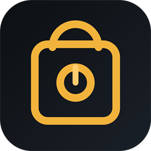

<div align="center">



# Keyward

**A local-first desktop password manager for Windows.**
Encrypted on your machine. No account. No sync. No telemetry. No recovery.

[](LICENSE)
[](docs/ENVIRONMENT.md)
[](tests/)
[](docs/SECURITY.md)
[](docs/ENVIRONMENT.md)

</div>

---

## Why this exists

Every mainstream password manager asks you to create an account before it will
keep a password. A password manager is the last place on your computer where an
account is warranted — you are handing it the keys to everything else.

Keyward stores one encrypted file on your disk. That is the whole product.


It tells you up front, before you choose a password, that **the password cannot
be recovered** — not by Keyward, not by anyone. That is the moment the
information is useful.

---

## Screenshots

| Unlock | The vault |
|---|---|
|  |  |

**Live strength guidance** — the estimate updates as you type, and is computed
from the actual password rather than a length rule of thumb.


---

## What it does

| | |
|---|---|
| **Encrypted at rest** | AES-256-CBC with HMAC-SHA-256 encrypt-then-MAC. Tampering is detected, not silently decrypted. |
| **Key derivation** | PBKDF2-HMAC-SHA512, 210,000 iterations, unique 256-bit salt per vault. Versioned and upgradeable. |
| **No recovery, by design** | Stated on first run. No backdoor, no reset link, no "we can help". |
| **Logins & secure notes** | Username, password, URL, notes, tags, folders, favourites. |
| **Search** | Across names, usernames, URLs, tags and note previews. `Ctrl`+`F`. |
| **Generator** | Passwords and pass-phrases from the OS CSPRNG, with unbiased character selection. |
| **Auto-lock** | 1 min – 1 hour, plus lock-on-sleep and lock-on-exit, with a visible countdown. |
| **Clipboard protection** | Auto-clear after 10 s – 5 min, and it reports whether the clear actually worked. |
| **Crash-safe writes** | Every save is atomic. A crash mid-write cannot destroy your vault. |
| **Backups & rotation** | Encrypted backup, and master password change that re-verifies the old one first. |

---

## Install

```powershell
git clone https://github.com/TanimowoObaloluwaDavid/Keyward.git
cd Keyward
.\install.ps1 -DesktopShortcut
```

Installs to `%LOCALAPPDATA%\Programs\Keyward` and adds Start Menu (and optional
desktop) shortcuts. No administrator rights needed. Your vault lives in
`%APPDATA%\Keyward\vault.kvw`, entirely separate from the application — so
updating or removing Keyward can never touch your data.

## Build from source

There is nothing to install: no package manager, no build tool, no dependencies.
The project compiles with the C# compiler that ships with Windows.

```powershell
.\build.ps1             # build into .\artifacts
.\build.ps1 -RunTests   # build, then run 86 tests
.\artifacts\Keyward.exe # run
```

Requires .NET Framework 4.x (present on Windows 10 and 11).

---

## Keyboard shortcuts

| Shortcut | Action |
|---|---|
| `Ctrl`+`F` / `Ctrl`+`K` | Search the vault |
| `Ctrl`+`N` | New login |
| `Ctrl`+`Shift`+`N` | New secure note |
| `Ctrl`+`D` | Copy the selected password |
| `Ctrl`+`E` | Edit the selected item |
| `Ctrl`+`L` | Lock the vault |
| `Ctrl`+`G` | Generator |
| `Ctrl`+`,` | Settings |
| `Esc` | Clear the search box |

---

## How it is built

```
src/
  Core/          no UI dependency at all
    Crypto/      SecureRandom · SecretBytes · AuthenticatedCipher · KeyDerivation · PasswordGenerator
    Domain/      Credential · SecureNote · Folder · VaultDocument
    Storage/     Json · AtomicFile · VaultFile
    Services/    VaultSession · Settings · AppPaths
    Platform/    paths and Windows ACLs
  Ui/
    Design/      Theme (palette, type, metrics) · Icons · Factory (control system)
    Screens/     WelcomeView · VaultView · GeneratorView · SettingsView
    App.cs       shell, routing, auto-lock, shortcuts
tests/           CryptoTests · StorageTests · SessionTests
tools/           build, install and QA helpers
docs/            security, design and implementation notes
```

Key material exists **only** inside `VaultSession`. `Keyward.Core` has no
reference to WPF or to anything in `Ui`, which is why the entire security
surface can be tested without a display.

All cryptography comes from `System.Security.Cryptography`. No primitive is
hand-rolled. All icons and the logo are original vector geometry defined in
code, so there are no third-party asset licences attached to this repository.

---

## Verification

**86 automated tests, all passing.** They cover the properties the security
claims actually rest on:

- Ciphertext, IV and MAC tampering are each detected and rejected
- KDF downgrade (lowering the iteration count or swapping the salt) invalidates the tag
- Two different passwords can never derive the same key
- The two sub-keys are never equal, and every seal uses a fresh IV
- A wrong master password is indistinguishable from a tampered file
- New vaults are written immediately, and survive a restart
- Corrupt, empty, truncated and hostile JSON is rejected rather than guessed at
- No `System.Random`, and no modulo bias in random selection

Two real defects were found and fixed by this suite during development — most
seriously, a bug where every vault was being encrypted under an **all-zero
key**. See [`docs/IMPLEMENTATION-REPORT.md`](docs/IMPLEMENTATION-REPORT.md).

---

## Documentation

| Document | Contents |
|---|---|
| [`docs/SECURITY.md`](docs/SECURITY.md) | Threat model, cryptographic design, and an explicit list of what this does **not** protect against |
| [`docs/DESIGN.md`](docs/DESIGN.md) | Brand direction, palette, typography, component system |
| [`docs/ENVIRONMENT.md`](docs/ENVIRONMENT.md) | Why C#/WPF and not Tauri, Electron or Flutter — with the measurements behind it |
| [`docs/IMPLEMENTATION-REPORT.md`](docs/IMPLEMENTATION-REPORT.md) | What was built, how it was verified, and what is missing |

---

## Known limitations

Stated plainly, because a password manager that oversells itself is worse than
one that does not exist.

- **It has never been audited, penetration tested, or certified.** No third
  party has reviewed this code. The tests prove the properties listed above; they
  do not prove the absence of defects.
- **Import and export are not implemented.** There is no button for them rather
  than one that produces a half-working file.
- **Windows only.** Tauri and Electron were not buildable on the target machine
  (see [`docs/ENVIRONMENT.md`](docs/ENVIRONMENT.md)); the core layer has no UI
  dependency, so other platforms remain a realistic but unbuilt follow-up.
- **PBKDF2 is parallelisable on GPUs.** Argon2id would be stronger. The KDF
  envelope is versioned and authenticated so that migration is a contained change.
- **Malware or a compromised OS defeats any local vault**, including this one.

---

## Licence

[MIT](LICENSE) © Tanimowo Obaloluwa David
